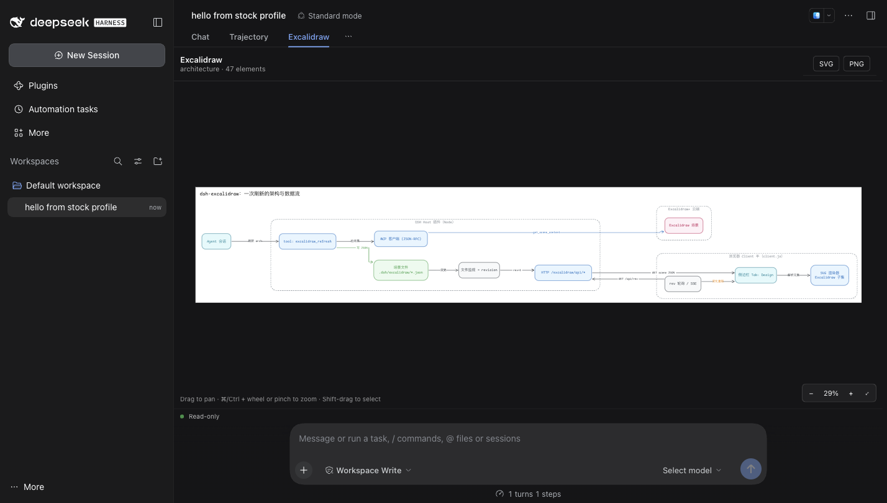
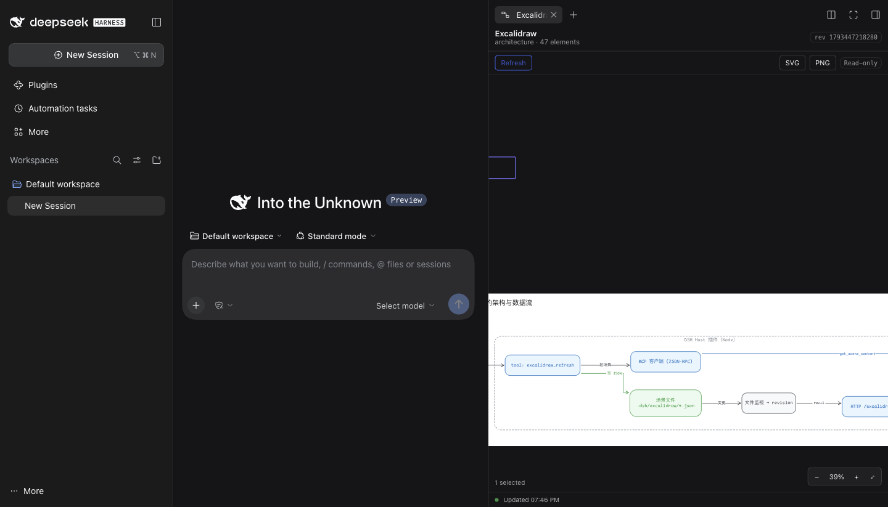

# dsh-excalidraw

Show **live Excalidraw architecture scenes in the DSH sidebar.**

Ask the agent to draw or refresh the code architecture in Excalidraw;
dsh-excalidraw pulls the scene through the Excalidraw+ MCP server, stores it in the
workspace, and the **Excalidraw** sidebar tab re-renders it — no page refresh, no
screenshots.

```
agent ──▶ tool: excalidraw_refresh ──▶ Excalidraw+ MCP (get_scene_content)
                                         │
                                         ▼
                       <cwd>/.dsh/excalidraw/<slug>.excalidraw
                                         │  (revision bump + focus pointer)
                                         ▼
  sidebar tab «Excalidraw» ◀── /excalidraw/api/* ◀── host HTTP routes
```

Design drawn in Excalidraw before a line of code:
[architecture](https://app.excalidraw.com/s/9Zq6XgRe98z/6gbUPPB8Q7X) ·
[sidebar wireframe](https://app.excalidraw.com/s/9Zq6XgRe98z/Aw55m5vJxYJ)

## Preview

The **Excalidraw** view on a stock DSH, beside Chat and Trajectory:



The same scene as the **Excalidraw** tab in dsh-better-sidebar:



## Install

```sh
# from a directory that holds this package
dsh plugin --profile desktop add "$PWD"
# then restart DSH so the Host row and the client bundle load
```

The version here is a plain ESM bundle: no build step is needed at install time
(`client.js` is committed). `npm run build` rebuilds it, however, so a checkout edited
in `src/` must be rebuilt before installing.

When this repository lives inside LayerFS (as it does in `tokenaissance`), export it
to a real host directory first — `dsh plugin add` needs a filesystem path:

```sh
# from a session bound to the LayerFS project
layerfs fs read main /dsh-excalidraw/...  # or mount a Workspace and copy the tree out
dsh plugin --profile desktop add /path/to/exported/dsh-excalidraw
```

**Two ways in.** *Local import* works with no account at all: point
`excalidraw_import` at a `.excalidraw`/`.json` file in the workspace, or hand it
an inline Excalidraw JSON document, and the view renders it. *Excalidraw+ refresh*
needs an account and a token (below).

**Refresh prerequisite: an Excalidraw+ MCP token.** Pulling a scene from Excalidraw+
(`excalidraw_refresh`, the tab's Refresh button) needs an Excalidraw+ account and
its MCP bearer token — set `mcpToken` on the plugin row, or `EXCALIDRAW_MCP_TOKEN`,
or keep the `Authorization: Bearer …` header your profile already has for the
`excalidraw` MCP server; when empty, the tool fails at the MCP endpoint. Without a
token the viewer still works read-only for what is already local: the
`.excalidraw` file viewer opens any scene file, and the Excalidraw view renders
scenes already present in `<workspace>/.dsh/excalidraw/`.

Requirements: DSH 0.2.1-rc.1+ (the Excalidraw view renders on DSH's own
`conversation.view` slot, so **no third-party sidebar is required**). With
[dsh-better-sidebar](https://github.com/omdsh-dev/DSH-better-sidebar) 0.28+ you
additionally get the right-sidebar tab, the `.excalidraw` file viewer, the file
icon and the auto-open focus watcher.

## Interactions (preview only)

The scene view is a **read-only viewer**, but its navigation follows Excalidraw's:

| Gesture | Effect |
| --- | --- |
| drag (or middle-drag) | pan |
| wheel / two-finger scroll | pan (shift: horizontal) |
| ⌘/Ctrl + wheel, or pinch | zoom at the cursor |
| click | select the topmost element under the cursor |
| Shift + click | add/remove that element from the selection |
| Shift + drag | marquee-select everything the rectangle touches |
| ⌘/Ctrl + A | select every element · `Esc` clears |
| double-click | fit the scene (on an element: zoom to that element) |
| `+` / `-` / `0` | zoom in / out / back to 100% |
| `Shift+1` or `Home` | fit to the window |
| `Shift+2` | zoom to the selection |
| arrow keys | pan by 40 px |

The zoom control in the bottom-right shows the current percentage and offers
fit / 100%. Selection is drawn as an outline and never changes the scene: there is
no editing, moving or resizing.

## Use

1. Ask the agent to refresh the architecture, e.g.
   *“把代码架构刷新到 Excalidraw，然后侧边栏给我看”*.
   The agent calls `excalidraw_refresh` with the Excalidraw+ scene id.
2. The host pulls `get_scene_content`, writes
   `<cwd>/.dsh/excalidraw/architecture.excalidraw`, bumps the revision and
   leaves a `focus` pointer for the calling session.
3. The **Excalidraw** tab opens (or refocuses) and renders the scene as SVG. Later
   refreshes re-render in place; the tab polls `/excalidraw/api/rev` while it is
   visible, so nothing else is needed.

Extras that come with the same sidebar service:

- any `.excalidraw` file opens in the sidebar as a diagram (read-only) instead
  of raw JSON; legacy `.excalidraw.json` scenes stay readable through the Excalidraw
  tab (better-sidebar only sniffs content for files with a head, so those keep
  opening in the JSON preview);
- the file tree shows the diagram glyph for those files;
- the tab's own **Refresh** button re-pulls the last stored scene.

## Tools

| Tool | Arguments | Effect |
| --- | --- | --- |
| `excalidraw_refresh` | `{ sceneId?, name?, slug? }` | pull a scene from Excalidraw+ into the workspace store; returns `{ ok, slug, file, sceneId, elements, revision, opened }` |
| `excalidraw_import` | `{ path?, scene?, name?, slug? }` | store a scene that already exists locally — a `.excalidraw`/`.json` file **inside the workspace**, or an inline Excalidraw JSON document — **no Excalidraw+ account or token** |
| `excalidraw_open` | `{ slug? }` | focus the Excalidraw tab for an already-stored scene |
| `excalidraw_export` | `{ slug?, format? }` | write the scene as `<scenesDir>/<slug>.svg` (PNG comes from the tab's button, which rasterises in the browser) |

The tab has no plugin-local settings: auto-open follows the host's `autoOpen`, and
the poll interval is the host's `pollIntervalMs` (delivered to the client in
`/rev`).

## Fonts

The plugin ships the Excalidraw web fonts it can redistribute — Comic Shanns
(MIT), Virgil (SIL OFL) and Lilita One (SIL OFL) — and serves them from the
package, so a scene's hand-drawn text renders the way Excalidraw draws it without
any third-party request. `Excalifont` (Excalidraw's own default) is **not**
included because it carries no licence grant; scenes that use it fall back to the
browser's font stack. See `fonts/README.md` and `docs/FIDELITY.md`.

## Configuration (cordis row `config`)

| key | default | meaning |
| --- | --- | --- |
| `mcpUrl` | `https://api.excalidraw.com/api/v1/mcp` | Excalidraw+ MCP endpoint |
| `mcpToken` | `''` | bearer token; when empty it falls back to `EXCALIDRAW_MCP_TOKEN`, then to the profile's own `mcp-excalidraw` row |
| `scenesDir` | `.dsh/excalidraw` | scene directory, relative to the session workspace |
| `extraFontsDir` | `''` | optional directory of user-supplied fonts (`fonts.json` + files); served to the tab and used by exports — the legal way to add Excalifont |
| `pollIntervalMs` | `1500` | client revision-poll interval (500–10000) |
| `autoOpen` | `true` | open/focus the tab after a refresh |
| `maxSceneBytes` | `4194304` | refuse larger scene files |

## How it is built

- **Host half** (`index.js` + `lib/`): a cordis plugin that registers seven HTTP
  routes plus the `/excalidraw/fonts/` prefix, three model tools, and a per-workspace scene store with atomic writes and
  a monotonic revision. Zero runtime dependencies; the Excalidraw MCP client is
  plain `fetch` + JSON-RPC over streamable HTTP.
- **Client half** (`client.js`, generated from `src/client.mjs` +
  `src/renderer.mjs` + `src/fonts-data.mjs` by `scripts/build-client.mjs`): one
  `window.__ModuleLoader__.load` module that mounts the scene view on **two
  surfaces** — DSH's native `conversation.view` slot (an **Excalidraw** view beside
  Chat/Trajectory, so a stock DSH works) and, when present, the
  dsh-better-sidebar tab with its file viewer and file icon.
- **Renderer** (`src/renderer.mjs`): pure, deterministic Excalidraw→SVG for the
  element subset the diagram tools emit; no `@excalidraw/*` dependency.

Read [docs/DESIGN.md](docs/DESIGN.md) for the design, [docs/CONTRACT.md](docs/CONTRACT.md)
for the normative wire contract, and [docs/HOST-NOTES.md](docs/HOST-NOTES.md) /
[docs/CLIENT-NOTES.md](docs/CLIENT-NOTES.md) / [docs/RENDERER-NOTES.md](docs/RENDERER-NOTES.md)
for per-half implementation notes.

## No Excalidraw+ account?

```text
agent ── excalidraw_import { path: "docs/flow.excalidraw" } ──▶ <cwd>/.dsh/excalidraw/flow.excalidraw
agent ── excalidraw_import { scene: { type: "excalidraw", elements: [...] } } ──▶ same store
```

Either form stores the scene locally and shows it in the **Excalidraw** view; the
file viewer opens `.excalidraw` files directly as well. Only `excalidraw_refresh`
(the pull from Excalidraw+) requires the token.

## Publish / install from elsewhere

- **Any DSH:** Settings → Plugins → *Add plugin* accepts a local directory, a
  `.tgz`, or a Git URL; the CLI equivalent is
  `dsh plugin --profile desktop add <source>`.
- **npm:** `npm publish --access public`, then install by name
  (`dsh plugin --profile desktop add dsh-excalidraw`).
- **Community catalog:** one YAML entry in
  [awesome-dsh-plugin](https://github.com/awesome-dsh-plugin/awesome-dsh-plugin)
  (`data/plugins/<owner>__<repo>.yml`); the market and Plugins → Discover pick
  it up after merge.

See [docs/PUBLISHING.md](docs/PUBLISHING.md) for the exact commands, the
catalog entry, and the pre-announcement checks.

## Tests

```sh
npm test        # node --test test/ (212 tests, zero deps) — it does NOT rebuild:
                # a stale client.js fails the build-signature test on purpose
npm run build   # regenerate src/fonts-data.mjs and client.js
node scripts/render-scene.mjs test/fixtures/design-scene.json /tmp/design.svg
```

The renderer is checked against the Excalidraw-rendered reference of the same
scene (ink coverage and aspect ratio), the store and MCP client have unit tests,
the host routes are exercised handler-by-handler, and the client module is loaded
through a stubbed module loader.

## Limits (v1)

Read-only: editing stays in Excalidraw (the viewer pans, zooms, selects and
marquees, but never writes the scene back). `roughness`/hachure are rendered clean;
`image` elements render only from a `data:image/…;base64,` URL already in the
scene's `files`; nothing is fetched from the network. Excalidraw's fonts are not
shipped, so family 5 (`Excalifont`) renders with the shipped **Virgil** fallback,
which is what Excalidraw's own stack does; families 2/3/4/6 fall back to the
browser stack. `Comic Shanns` (8), `Virgil` (1) and `Lilita One` (7) ship.
